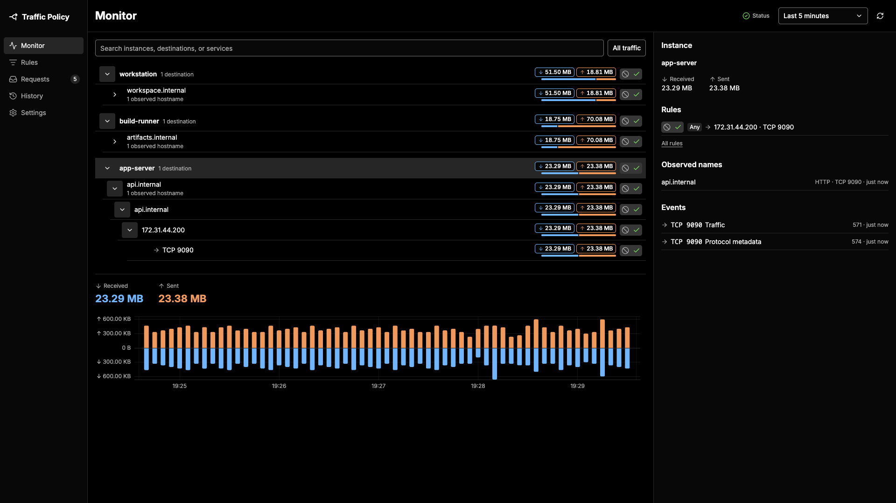
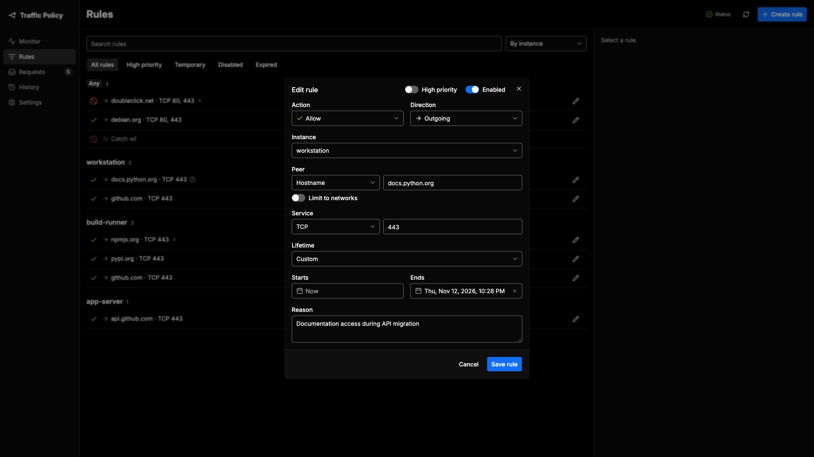

# Traffic Policy

Network visibility and traffic control for Linux gateways. Apply firewall
policies to hosts and subnets, with DNS authorization and connection
enforcement.

A web dashboard provides traffic inspection, rule management, and review of
blocked requests.

| Monitor                                                     | Rule editor                                                                                    |
| ----------------------------------------------------------- | ---------------------------------------------------------------------------------------------- |
|  |  |

## What it does

- Apply rules to every instance, one instance, or an address range, matching
  addresses, domains, protocols, and ports, with priorities and expiration
  times. Instances can be hosts or whole subnets; nested ones inherit their
  parents' rules.
- Keep shared rules in rule sets and attach each set to the instances that need
  it.
- Block hosts on client networks until they are registered, and list them as
  registration requests.
- Choose whether DNS answers require prior connection approval.
- Monitor sent and received traffic, group peers by domain, and inspect
  connection evidence.
- Review the history of policy changes.

The application runs on a routed Linux gateway. It manages network instances,
not per-process permissions on a desktop.

## Architecture

The controller owns the dashboard, authentication, desired policy, and history.
An unprivileged gateway service authorizes DNS answers and delivers observations
to the controller. A separate privileged enforcement service, limited to
`CAP_NET_ADMIN`, applies nftables updates. Suricata supplies passive metadata.
Machine APIs use mutual TLS.

Read the [architecture](docs/ARCHITECTURE.md) for system and policy behavior,
the [API contract](API_CONTRACT.md) for wire formats, and the
[visual design system](DESIGN.md) for presentation.

## Run it

Follow the [setup guide](docs/SETUP.md) for configuration, machine identities,
Admin initialization, and Linux services. The
[example configurations](examples/) are templates.

The service definitions target Linux x64 with glibc and systemd. Deployment
requires nftables, conntrack, Suricata, and a configured routing topology.
Network commissioning is manual; the project does not configure routing or
client DNS.

## Development

See the [verification guide](docs/VERIFICATION.md) for builds, checks, and
gateway testing.

## Repository layout

| Path                  | Purpose                                                              |
| --------------------- | -------------------------------------------------------------------- |
| `packages/contracts/` | Validated shared data and wire contracts                             |
| `packages/core/`      | Rule precedence, DNS permissions, and native compilation             |
| `apps/gateway/`       | Enforcement service, resolver gate, collection with durable delivery |
| `apps/controller/`    | Dashboard, services, SQLite, and gateway link                        |
| `tools/`              | Build, runtime, and Admin setup tooling                              |
| `packaging/linux/`    | Linux service units, sysctls, and pinned runtime metadata            |
| `examples/`           | Deployment configuration templates                                   |
| `dev/docker/`         | Development stack for end-to-end checks                              |
| `DESIGN.md`           | Visual design and component recipes                                  |
| `docs/`               | Architecture, setup, and product behavior                            |

## Security

Report vulnerabilities privately as described in the
[security policy](SECURITY.md).

## License

Project-authored code is available under the [MIT license](LICENSE).
[Third-party notices](docs/THIRD_PARTY.md) identify copied source, datasets, and
fonts with their own licenses.
